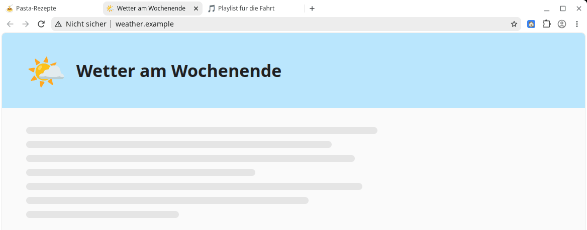
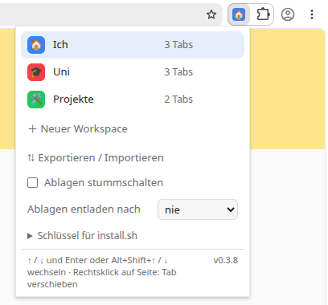

# Helium Workspaces

[English](./README.md) · **Deutsch**

Helium Workspaces bringt Arbeitsbereiche wie in Opera in den [Helium-Browser](https://github.com/imputnet/helium-linux): mehrere Tab-Sätze im selben Fenster, umschaltbar per Klick oder Tastenkürzel. Beim Wechseln wird nichts neu geladen, Videos und Logins laufen einfach weiter.



Besteht aus einer Browser-Erweiterung und einem kleinen KWin-Skript für KDE Plasma. Die Erweiterung spricht Deutsch und Englisch und richtet sich nach der Sprache des Browsers.

## „Warum nicht einfach Profile?“

Profile trennen alles: Logins, Verlauf, Erweiterungen, und jedes Profil braucht ein eigenes Fenster. Ich wollte nur die Tabs trennen, zum Beispiel „Ich“ und „Uni“, und trotzdem überall eingeloggt bleiben.

Helium hat das nicht eingebaut, also habe ich es gebaut.

## So funktioniert's

Jedes normale Fenster zeigt genau einen Workspace. Die Tabs der anderen Workspaces liegen in versteckten **Ablage-Fenstern**, eins pro Workspace. Beim Wechseln werden die Tabs zwischen den Fenstern verschoben, nicht geschlossen, deshalb bleiben sie geladen. Das KWin-Skript versteckt die Ablage-Fenster vor Taskleiste und Alt+Tab. Mehr unter [So funktioniert's](./docs/how-it-works.de.md).

### Grenzen

- Tabs in Ablagen bleiben geladen. Sie brauchen weiter Arbeitsspeicher, und Videos oder Musik laufen im Hintergrund weiter. Mit **Ablagen stummschalten** in der Workspace-Liste sind sie dabei wenigstens stumm. Mit **Ablagen entladen nach** werden sie nach einer gewählten Zeit entladen (siehe [Ablagen entladen](./docs/usage.de.md#ablagen-entladen)).
- Angeheftete Tabs gehören zu allen Workspaces und bleiben immer im Hauptfenster.
- Mehrere Fenster können denselben Workspace zeigen, etwa nach <kbd>Strg</kbd>+<kbd>N</kbd>.
- Inkognito-Fenster werden nicht berücksichtigt.
- Ohne das KWin-Skript funktioniert die Erweiterung auch, die Ablage-Fenster sind dann aber als minimierte Fenster sichtbar.

## Voraussetzungen

- [Helium](https://github.com/imputnet/helium-linux) unter Linux. Getestet mit Helium 0.21. Google Chrome und Chromium ab Version 102 gehen auch, andere Browser wie Brave müssen erst in die Liste des KWin-Skripts, siehe [Google Chrome, Chromium und andere Browser](./docs/how-it-works.de.md#google-chrome-und-chromium).
- KDE Plasma 6 mit KWin 6, unter Wayland oder X11. Andere Desktops verstecken die Ablage-Fenster nicht.
- Für `install.sh`: `bash`, `sed`, `tr` und `git` sowie `kpackagetool6`, `kreadconfig6`, `kwriteconfig6` und `qdbus6`. Bei Arch heißen die Pakete `coreutils`, `kpackage`, `kconfig` und `qt6-tools`. Statt `qdbus6` nimmt `install.sh` auch `qdbus-qt6` (so bei Fedora) oder `qdbus`. Fehlt etwas, nennt `install.sh` die Programme und bricht ab, bevor es etwas ändert.
- Eine laufende Plasma-Sitzung. `install.sh` lädt das Skript über den D-Bus dieser Sitzung direkt in KWin. Am sichersten in einem Terminal innerhalb der Sitzung starten.
- In Helium unter *Einstellungen → Beim Start* die Option **„Dort weitermachen, wo ich aufgehört habe“**. Mit einer anderen Starteinstellung stellt Helium die Ablage-Fenster beim Start nicht wieder her. Die Erweiterung baut die Workspaces dann aus ihrer Sicherung neu auf, die Tabs laden dabei aber neu und verlieren ihren Verlauf (siehe [Was erhalten bleibt](./docs/usage.de.md#was-erhalten-bleibt)). `install.sh` nennt am Ende die Profile von Helium, Google Chrome und Chromium, in denen die Erweiterung installiert ist, die Option aber fehlt, und ändert dort nichts.

## Installation

1. Repository klonen:

   ```bash
   git clone https://github.com/Jerry0205dotde/helium-workspaces.git
   cd helium-workspaces
   ```

2. In Helium `chrome://extensions` öffnen und oben rechts den **Entwicklermodus** einschalten.
3. **Entpackte Erweiterung laden** wählen und den Ordner `extension/` aus dem Repository auswählen.
4. Den Workspace-Button in der Symbolleiste anheften.
5. Den Workspace-Button anklicken, unten **Schlüssel für install.sh** aufklappen und auf **Kopieren** klicken. Das kopiert den fertigen Befehl samt Schlüssel:

   ```bash
   ./install.sh <Schlüssel>
   ```

   Ihn in einem Terminal im Repository-Ordner einfügen und ausführen. Er richtet das KWin-Skript ein.

   Am Ende steht `Fertig, KWin-Skript <Version> installiert.`. Das KWin-Skript ist dann installiert, aktiviert, geladen und kennt den Schlüssel. `install.sh` antwortet auf Deutsch, wenn die Sprache der Sitzung Deutsch ist (`LANGUAGE`, `LC_ALL`, `LC_MESSAGES` oder `LANG`), sonst auf Englisch. `./install.sh --help` zeigt alle Optionen.
6. Zum Prüfen einen zweiten Workspace anlegen und hin- und herwechseln. In der Taskleiste darf kein zusätzliches Browserfenster auftauchen.

Helium lädt die Erweiterung bei jedem Start aus genau diesem Ordner. Wird er verschoben oder an anderer Stelle neu geklont, in `chrome://extensions` mit **Entpackte Erweiterung laden** den neuen Ordner `extension/` wählen. Workspaces, Sicherung und Schlüssel bleiben dabei erhalten, denn das Feld `key` in [`manifest.json`](./extension/manifest.json) gibt der Erweiterung unabhängig vom Ordner immer die ID `jchklfejnmfphkbcpnhdejmeoncejjbe`. Den Entwicklermodus eingeschaltet lassen. Ohne ihn deaktiviert Helium entpackte Erweiterungen.

### Aktualisieren

Es gibt keine automatischen Updates. Helium lädt die Erweiterung direkt aus dem Repository-Ordner, eine neue Version kommt also erst an, wenn du sie selbst holst.

Wer von Version 0.2.23 oder älter aktualisiert, braucht vorher einen Export: siehe [Umstieg auf die feste Erweiterungs-ID](./docs/updating.de.md#einmalig-umstieg-auf-die-feste-erweiterungs-id-ab-version-030).

1. Neuen Stand holen und das KWin-Skript aktualisieren:

   ```bash
   cd helium-workspaces
   ./install.sh --update
   ```

   Das führt `git pull --ff-only` aus und richtet das KWin-Skript ohne Rückfrage neu ein. Schlüssel und Browserliste bleiben.
2. In `chrome://extensions` bei „Workspaces“ auf **Neu laden** (Kreispfeil) klicken. Ein Neustart von Helium reicht nicht, danach kann noch die alte Hintergrundlogik laufen. `install.sh` nennt am Ende die neue Version, das Popup zeigt sie unten rechts.

Die Erweiterung zum Aktualisieren nicht entfernen und neu hinzufügen. Beim Entfernen löscht Helium alle Workspaces und die Sicherung. Nur ein Export bleibt dann übrig, von Hand oder automatisch (siehe [Exportieren und importieren](./docs/usage.de.md#exportieren-und-importieren)).

## Benutzung

<picture>
  <source media="(prefers-color-scheme: dark)" srcset="docs/popup-de-dark.png">
  
</picture>

| Aktion | So geht's |
| --- | --- |
| Workspace-Liste öffnen | Button in der Symbolleiste oder <kbd>Alt</kbd>+<kbd>W</kbd> |
| Nächster / vorheriger Workspace | <kbd>Alt</kbd>+<kbd>Shift</kbd>+<kbd>↓</kbd> / <kbd>↑</kbd>, oder in der Liste <kbd>↓</kbd> / <kbd>↑</kbd> und <kbd>Enter</kbd> |
| Zurück zum zuletzt benutzten Workspace | <kbd>Alt</kbd>+<kbd>Q</kbd>, erneut drücken springt wieder hin (wie Alt+Tab) |
| Direkt zu Workspace 1–9 | Kürzel unter `chrome://extensions/shortcuts` selbst festlegen (Chromium schlägt höchstens vier vor), oder in der Liste <kbd>1</kbd>–<kbd>9</kbd> |
| Workspace anlegen, umbenennen, Farbe oder Emoji ändern, löschen | in der Liste |
| Reihenfolge ändern | in der Liste ziehen |
| Tab in einen anderen Workspace schieben | Rechtsklick irgendwo auf die Seite, auch auf einen Link, ein Bild oder markierten Text → **Tab in Workspace verschieben**, oder in der Liste auf ↪ neben dem Ziel |
| Link in einem anderen Workspace öffnen | Rechtsklick auf den Link → **Link in Workspace öffnen**. Der Tab öffnet sich im Hintergrund in einem Fenster, das den Workspace zeigt, sonst in seiner Ablage |
| Mehrere Tabs auf einmal schieben | Tabs mit <kbd>Strg</kbd> / <kbd>Shift</kbd> markieren, dann wie oben. Ganz markierte Gruppen behalten Titel und Farbe. |
| Ganze Tab-Gruppe schieben | in einem Tab der Gruppe Rechtsklick auf die Seite → **Gruppe in Workspace verschieben** |
| Workspaces exportieren oder importieren | in der Liste → **Exportieren / Importieren** |
| Ton eines Workspace ausschalten | in der Liste auf 🔊 neben dem Workspace klicken (erscheint, solange darin etwas zu hören ist) |
| Ton wieder einschalten | in der Liste auf 🔇 neben dem Workspace klicken (erscheint, solange darin etwas stumm läuft, das sonst zu hören wäre) |
| Nicht gezeigte Workspaces immer stumm | in der Liste **Ablagen stummschalten** anhaken. Beim Zurückholen bekommen die Tabs ihren Ton wieder, von Hand stummgeschaltete bleiben stumm. |
| Tabs nicht gezeigter Workspaces entladen | in der Liste → **Ablagen entladen nach** |

Rückgängig, Entladen, Export und Import, automatische Sicherung und was einen Neustart übersteht: [Benutzung im Detail](./docs/usage.de.md).

## Mehr

- [Probleme beheben](./docs/troubleshooting.de.md): Ablage-Fenster in der Taskleiste, `install.sh` bricht ab, fehlende Tabs
- [Aktualisieren und deinstallieren](./docs/updating.de.md): Umstieg auf die feste Erweiterungs-ID und alles entfernen, ohne dass Tabs unsichtbar weiterlaufen
- [So funktioniert's](./docs/how-it-works.de.md): Ablage-Fenster, der Schlüssel, Google Chrome, Chromium und andere Browser
- [Mitmachen](./CONTRIBUTING.de.md): Tests, Versionen und der Aufbau des Codes

Das ist ein privates Bastelprojekt. Rechne mit Fehlern.

## Lizenz

[GPL-3.0-or-later](./LICENSE). Du darfst Helium Workspaces benutzen, ändern und weitergeben, solange alles, was du darauf aufbauend weitergibst, ebenfalls unter der GPL steht und mit Quellcode kommt.
