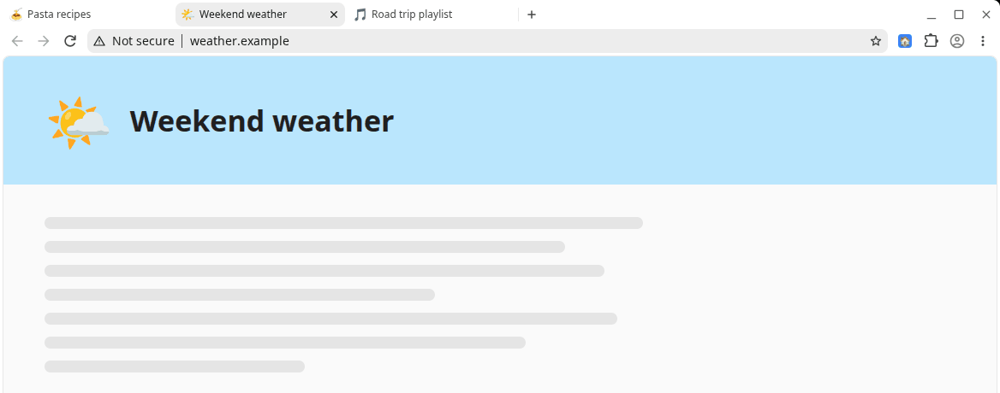
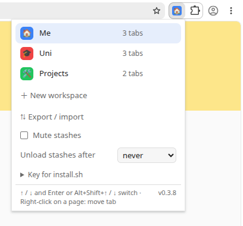

# Helium Workspaces

**English** · [Deutsch](./README.de.md)

Helium Workspaces brings Opera-style workspaces to the [Helium browser](https://github.com/imputnet/helium-linux): several sets of tabs in the same window, switchable by click or keyboard shortcut. Nothing reloads when you switch, so videos and logins simply keep going.



It consists of a browser extension and a small KWin script for KDE Plasma. The extension speaks English and German and follows the language of the browser. The UI names in this README are the English ones.

## "Why not just use profiles?"

Profiles separate everything: logins, history, extensions, and every profile needs its own window. I only wanted to separate the tabs, for example "Me" and "Uni", and still stay logged in everywhere.

Helium doesn't have that built in, so I built it.

## How it works

Every normal window shows exactly one workspace. The tabs of the other workspaces live in hidden **stash windows**, one per workspace. Switching moves the tabs between the windows instead of closing them, so they stay loaded. The KWin script hides the stash windows from the taskbar and Alt+Tab. More in [How it works](./docs/how-it-works.md).

### Limitations

- Tabs in stashes stay loaded. They keep using memory, and videos or music keep playing in the background. With **Mute stashes** in the workspace list they at least play silently. With **Unload stashes after** they are unloaded after a chosen time (see [Unloading stashes](./docs/usage.md#unloading-stashes)).
- Pinned tabs belong to all workspaces and always stay in the main window.
- Several windows can show the same workspace, for example after <kbd>Ctrl</kbd>+<kbd>N</kbd>.
- The extension only runs in incognito windows if you allow it under `chrome://extensions` in its details with **Allow in Incognito**. Each incognito session then has its own workspaces: it starts with those of the normal profile, without their tabs, and changes stay within it. Incognito tabs are not backed up, not automatically either, and are gone with the last incognito window.
- The extension also works without the KWin script, but the stash windows are then visible as minimized windows. The automatic backup needs `install.sh` too.

## Requirements

- [Helium](https://github.com/imputnet/helium-linux) on Linux. Tested with Helium 0.21. Google Chrome and Chromium 139 or newer work too; other browsers such as Brave first have to be added to the KWin script's list, see [Google Chrome, Chromium and other browsers](./docs/how-it-works.md#google-chrome-and-chromium).
- KDE Plasma 6 with KWin 6, on Wayland or X11. Other desktops do not hide the stash windows.
- For `install.sh`: `bash`, `sed`, `tr` and `git` as well as `kpackagetool6`, `kreadconfig6`, `kwriteconfig6` and `qdbus6`. On Arch the packages are called `coreutils`, `kpackage`, `kconfig` and `qt6-tools`. Instead of `qdbus6`, `install.sh` also accepts `qdbus-qt6` (as on Fedora) or `qdbus`. If anything is missing, `install.sh` lists the programs and stops before it changes anything. `python3` is only needed to remove an old entry of the extension from before 0.3.0 (see [Troubleshooting](./docs/troubleshooting.md#after-a-restart-the-extension-is-gone-and-stashes-show-err_blocked_by_client)).
- A running Plasma session. `install.sh` loads the script straight into KWin over the D-Bus of that session. The safest way is to run it in a terminal inside the session.
- In Helium, under *Settings → On startup*, the option **"Continue where you left off"**. With any other startup setting Helium does not restore the stash windows on startup. The extension then rebuilds the workspaces from its backup, but the tabs reload and lose their history (see [What is preserved](./docs/usage.md#what-is-preserved)). At the end, `install.sh` lists the Helium, Google Chrome and Chromium profiles that have the extension installed but lack this option, and changes nothing there.

## Installation

1. Clone the repository:

   ```bash
   git clone https://github.com/Jerry0205dotde/helium-workspaces.git
   cd helium-workspaces
   ```

2. Open `chrome://extensions` in Helium and turn on **Developer mode** in the top right.
3. Choose **Load unpacked** and select the folder `extension/` from the repository.
4. Pin the workspace button to the toolbar.
5. In a terminal in the repository folder, set up the KWin script and answer the question for the key with <kbd>Enter</kbd>:

   ```bash
   ./install.sh
   ```

   The last line of output is `Done, KWin script <version> installed.`. The KWin script is then installed, enabled and loaded. `install.sh` answers in German if the session language is German (`LANGUAGE`, `LC_ALL`, `LC_MESSAGES` or `LANG`), otherwise in English. `./install.sh --help` shows all options (in German).
6. Click the workspace button. The extension then sends its key to `native-host.sh`, which writes it to `kwinrc` (see [The key](./docs/how-it-works.md#the-key)). There is nothing to copy. For a browser that `install.sh` does not know, such as Brave, expand **Key for install.sh** at the bottom, click **Copy** and run the copied command `./install.sh <key>` in the repository folder.
7. To check, create a second workspace and switch back and forth. No additional browser window may appear in the taskbar.

Helium loads the extension from exactly this folder on every start. If it is moved or cloned again somewhere else, choose the new `extension/` folder with **Load unpacked** in `chrome://extensions`. Workspaces, backup and key are kept, because the `key` field in [`manifest.json`](./extension/manifest.json) always gives the extension the ID `jchklfejnmfphkbcpnhdejmeoncejjbe`, regardless of the folder. Leave developer mode turned on. Without it Helium disables unpacked extensions.

### Updating

There are no automatic updates. Helium loads the extension straight from the repository folder, so a new version only arrives when you fetch it yourself.

When updating from version 0.2.23 or older, you need an export first: see [switching to the fixed extension ID](./docs/updating.md#once-switching-to-the-fixed-extension-id-from-version-030).

1. Fetch the new version and update the KWin script:

   ```bash
   cd helium-workspaces
   ./install.sh --update
   ```

   This runs `git pull --ff-only` and sets up the KWin script again without asking. The key and the browser list are kept. When updating to 0.3.13 or later it also registers `native-host.sh`, which from then on writes new keys by itself. From 0.3.14 on, `native-host.sh` also writes the automatic backups, to `~/.local/share/helium-workspaces/backups/` instead of Downloads.
2. In `chrome://extensions`, click **Reload** (the circular arrow) on "Workspaces", or restart Helium. Since 0.3.32 the path of the background logic in `manifest.json` contains the version, so a restart loads the new one too; before that, Helium kept running the old one after a restart. At the end `install.sh` names the new version, the popup shows it in the bottom right.

Do not remove and re-add the extension to update it. When it is removed, Helium deletes all workspaces and the backup. Only an export is left then, manual or automatic (see [Export and import](./docs/usage.md#export-and-import)).

## Usage

<picture>
  <source media="(prefers-color-scheme: dark)" srcset="docs/popup-en-dark.png">
  
</picture>

| Action | How |
| --- | --- |
| Open the workspace list | Toolbar button or <kbd>Alt</kbd>+<kbd>W</kbd> |
| Next / previous workspace | <kbd>Alt</kbd>+<kbd>Shift</kbd>+<kbd>↓</kbd> / <kbd>↑</kbd>, or in the list <kbd>↓</kbd> / <kbd>↑</kbd> and <kbd>Enter</kbd> |
| Back to the last used workspace | <kbd>Alt</kbd>+<kbd>Q</kbd>, pressing it again jumps back (like Alt+Tab) |
| Straight to workspace 1–9 | set your own shortcuts at `chrome://extensions/shortcuts` (Chromium suggests at most four), or <kbd>1</kbd>–<kbd>9</kbd> in the list |
| Create a workspace, rename it, change its color or emoji, delete it | in the list |
| Change the order | drag in the list |
| Move a tab to another workspace | Right-click anywhere on the page, including a link, an image or selected text → **Move tab to workspace**, or click ↪ next to the target in the list |
| Open a link in another workspace | Right-click the link → **Open link in workspace**. The tab opens in the background in a window showing that workspace, otherwise in its stash |
| Move several tabs at once | Select the tabs with <kbd>Ctrl</kbd> / <kbd>Shift</kbd>, then as above. Fully selected groups keep their title and color. |
| Move a whole tab group | In a tab of the group, right-click the page → **Move group to workspace** |
| Export or import workspaces | in the list → **Export / import** |
| Mute a workspace | in the list, click 🔊 next to the workspace (shown while something in it is audible) |
| Unmute it again | in the list, click 🔇 next to the workspace (shown while something in it would be audible but is muted) |
| Always mute workspaces that are not shown | in the list, tick **Mute stashes**. Tabs get their sound back when they return; tabs muted by hand stay muted. |
| Unload the tabs of workspaces not shown | in the list → **Unload stashes after** |

Undo, unloading, export and import, automatic backup and what survives a restart: [Usage in detail](./docs/usage.md).

## More

- [Troubleshooting](./docs/troubleshooting.md): stash windows in the taskbar, `install.sh` aborts, missing tabs
- [Updating and uninstalling](./docs/updating.md): switching to the fixed extension ID and removing everything without tabs running on invisibly
- [How it works](./docs/how-it-works.md): stash windows, the key, Google Chrome, Chromium and other browsers
- [Contributing](./CONTRIBUTING.md): tests, versions and the structure of the code

This is a private hobby project. Expect bugs.

## License

[GPL-3.0-or-later](./LICENSE). You may use, change and share Helium Workspaces, as long as anything you pass on based on it is also under the GPL and comes with its source code.
